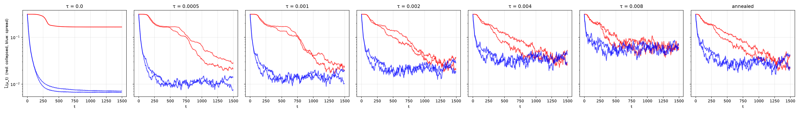
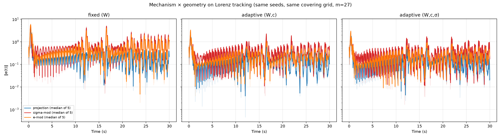
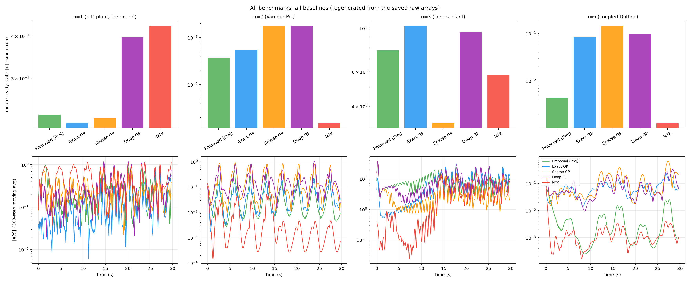

# Transport Adaptive Control: Adaptive Kernel Approximators as Evolving Measures

**Copyright (c) 2026 Odwitiyo Dutta. All Rights Reserved.** See [LICENSE](LICENSE).

This repository holds a research program on continuous-time adaptive control with Gaussian RBF networks, whose
weights, centres and widths are all adapted online. It has two parts.

1. **The controller and its audit.** A Lyapunov-based adaptive RBF controller with a boundary-layer projection
   operator, together with an honest re-evaluation of its claims ([ASSESSMENT.md](ASSESSMENT.md),
   [THEORY_REVISED.md](THEORY_REVISED.md)).
2. **Transport adaptive control.** A new theory that treats the network as a probability measure on a lifted
   parameter space and the adaptive law as transport of that measure ([PARADIGM.md](PARADIGM.md)). Stability,
   robustness modifications, excitation, the many-kernel limit, the slow evolution of kernel geometry and the global
   placement of kernels all become statements on Wasserstein space, independent of how the kernels are labelled.

**The manuscript.** [lyapunov.pdf](lyapunov.pdf) is the complete mathematical treatment of both parts: every result
with its proof and status, the numerical evidence and the verification map. It is version 3 (version 4 of the
theory: Lemma E.0, Theorems C′, D′, I, J and Proposition K added) and supersedes versions 2 and 1 of the same name,
whose claims it re-examines in its Section 2. The LaTeX source is in [manuscript/](manuscript).

**Status.** This is research in progress and has not been peer reviewed.

- Every result in [PARADIGM.md](PARADIGM.md) is labelled *proved*, *formal* (a derivation without error control)
  or *conjectural*.
- Every inequality the tests can evaluate is checked numerically along simulated trajectories, and every number in
  the documents is produced by a script in [experiments/](experiments).
- The theory went through three rounds of automated multi-agent adversarial review, and the manuscript through a
  fourth that compared it line by line with the theory. Every confirmed issue and its fix is logged in
  [review/REVIEW_LOG.md](review/REVIEW_LOG.md), and the raw reports of rounds 1–3 and 5–14 are kept beside it.
- The claim-by-claim novelty audit is in [LITERATURE_TRANSPORT.md](LITERATURE_TRANSPORT.md).
- Version 4 of the theory adds a self-contained strict Lyapunov function for Theorem E (Lemma E.0, with the sharp slow-regime
  version Lemma E.0′), a theorem that
  characterises the non-reciprocity of the averaged closed loop (Theorem I), the finite-m averaging theorem for the real
  closed loop (Theorem J), propagation of chaos for the dithered loop (Theorem D′), the barycentric OT leak
  (Theorem C′) and the orientation of the reference orbit as a design input for collapsed configurations
  (Proposition K); see [review/REVIEW_LOG.md](review/REVIEW_LOG.md) round 5 for their adversarial review. The second
  increment adds the sharp slow-regime rate (Lemma E.0′), uniform-in-time propagation of chaos in the leak-dominated regime
  (Theorem D″) and the stationary law of the dithered finite-size loop with its non-equilibrium current (Theorem J′,
  Proposition J′.2); round 6 of the review log covers them. The third increment adds the explicit stationary parameter spread
  of the dithered linearised loop (Corollary E.0′.3) and the slow-regime Lyapunov function for non-periodic persistently
  exciting regressors (Lemma E.0″), and uniform-in-time propagation of chaos in the learning regime for the averaged
  slow loop (Theorem D‴: the flat convexity of the loss makes the particle interaction contract, and the fitted
  configuration's second-order optimality replaces the dominant leak), with the finite-size weight-sensitivity law (Proposition D‴.5),
  the real loop on a warm start (Corollary D‴.7), the leak's prior as a design input of the window (Proposition D‴.9) and the
  barycentric OT leak's mass constraint, which removes the finite-size floor (Proposition D‴.12) — in the real loop too, where the
  collapsed subspace carries one K₀-atom orbit for every commensurate size (Corollary D‴.14, Proposition D‴.15) and Theorem J holds
  uniformly in the number of kernels in the per-particle norm (Theorem D‴.18), while a soft (entropic) mass constraint equalises the
  masses only down to a critical excess (Proposition D‴.20); rounds 7–13 of the review log cover the first five and their remarks.

---

## Part 2 (new): transport adaptive control

The network f̂ = (1/m)Σ a_i φ(x; c_i, s_i) is read as the empirical measure μ = (1/m)Σ δ_{ϑ_i} of its lifted
particles ϑ_i = (a_i, c_i, s_i). The output is linear in μ, and the adaptive law moves μ.

| result | statement | status |
|---|---|---|
| A | The adaptive law is the particle form of a Wasserstein gradient flow of a μ-linear potential | proved; interpretive |
| B | A label-free Lyapunov function ½‖e‖² + ½W(μ, μ*)², with a two-regime matched remainder | proved and checked |
| C | Optimal-transport σ-modification: exact dissipation, a gap-protected strict inequality, a local exponential estimate; the labelled leak reshuffles kernels | proved and checked |
| D | The mean-field closed loop: well-posedness, a Dobrushin estimate, the many-kernel limit | proved |
| E | Label-free local exponential convergence under tangential persistent excitation, with explicit radius, overshoot and rate (Lemma E.0: a self-contained strict Lyapunov function; Lemma E.0′: in the slow-adaptation regime a second one whose rate is the averaged rate λ_min⟨ΨᵀΨ⟩/k up to a factor 1 − δ, paying for the ill-conditioning of the excitation once); under dither the same function bounds the stationary parameter spread explicitly (Corollary E.0′.3); for references that are not periodic, an exponential average over a window replaces the period mean and the rate becomes the window's weighted excitation level over k_e, up to a factor 1 − δ − O(1/k_e) (Lemma E.0″) | proved and checked; E.0's rate is conservative in a quantified way, E.0′'s is within 12% of the exact rate above its threshold |
| F | The Wasserstein length of learning is bounded by the integrated tracking error | proved and checked |
| G | The slow kernel geometry follows variable projection in the metric induced on the slow manifold; plain variable projection needs a flatness condition | formal; checked, with a counterexample |
| H | With saturated features, σ-modification and parameter dither, the averaged loop is mean-field Langevin dynamics and converges globally to the regularised optimum | proved for the averaged system |
| H.7 | At finite feedback gain, the averaged loop is *not* a gradient flow: a semi-gradient (performative) correction, and an antisymmetric kernel interaction given by the area the reference orbit encloses | frozen-measure part proved; non-reciprocity checked and characterised by Theorem I |
| H.8 | The averaged system is input-to-state stable, which reduces the global conjecture for the real loop to an averaging estimate | proved under a stated regularity assumption |
| J | At finite m without dither, every hyperbolic critical point of the regularised occupation loss has a unique nearby periodic orbit of the real closed loop with the same stability type, O(1/k_e) away, whose first-order location is the one Proposition H.7 and Remark H.7a predict | proved and checked |
| D′ | Finite-horizon propagation of chaos for the dithered loop with the plant in the loop, at the rate m^{−1/2} — whose exponent is dimension-free — for the state and the learned function; uniform in time when the leak dominates the adaptive law's loop gain (Theorem D″; in that leak-dominated regime the network does not learn, and in the learning regime a 1000 s run shows the coupled distance growing, so uniformity there stays open) | proved; the rate checked over 24 seeds, the uniform bound on certified runs with and without dither |
| D‴ | Uniform-in-time propagation of chaos *while the network learns*, for the averaged slow loop without dither: the interaction between particles contracts because the loss is a convex quadratic of the fitted function, and what can expand is only the residual-weighted curvature of the features, which the second-order optimality of the fitted configuration keeps below the leak; the constants are explicit, the hypothesis is computable along the mean-field flow, and it is compatible with the instability of the collapsed configuration (the learning regime). A connected cold start whose mass splits between basins is outside it: there the coupling carries a floor of pairs in different basins. The finite-size floor is the memory of the initial cluster masses, which the leak conserves; the OT leak of Theorem C′ constrains them instead, and on sizes commensurate with the prior's masses the finite-size stationary measure is the mean-field one exactly (Proposition D‴.12). | proved (averaged slow loop); real loop open; numerics: `exp_chaos_learning.py`, `exp_ot_leak.py` |
| C′ | The OT leak toward a prior with a different number of kernels (barycentric projection of the optimal plan) is the continuous-time Lloyd descent of coverage control used as a leak: it dissipates to the equal-mass centroidal configurations of the prior, and its Lyapunov bias is the ideal's distance from the centroids of its prior cells | proved (for generalised solutions) and checked |
| K | At a collapsed kernel configuration the stability splits into a separation block, independent of the network size, and a collective block; the collapse is a strict minimum iff the leak exceeds a critical gain σ_crit, and near σ_crit the direction in which the reference orbit is traversed decides whether the kernels separate — a design rule computable from the averaged data | proved (the orientation part given the second-order normal form) and checked |
| J′ | With dither at finite size, the loop's stationary law is the Gibbs measure of the regularised loss up to O(1/k_e), with an explicit first-order correction driven by the same non-reciprocal drift as Theorem J; the stationary tracking error is the Gibbs-averaged occupation loss over k_e²/2; the stationary state carries a probability current, and the parameter process is not time-reversible, exactly when that drift is not reciprocal (always, for three or more kernels) | proved (three standard theorems imported) and checked |
| I | Reciprocity of the exactly averaged loop at order 1/k_e² is a pairwise property; for n = 1 it holds exactly when the residual vanishes on the orbit, at perfect fit in n ≥ 2 exactly when the orbit carries no circulation and the residual's Jacobian is symmetric along it; no open set of measures is reciprocal, so the averaged loop is nowhere a gradient flow at this order | proved and checked |

**A new closed-loop effect.** Traversing the same reference orbit in the opposite direction leaves the visited
states unchanged, yet the learned kernels shift by an amount of order 1/k_e. The first-order theory, H.7 plus the
second-order averaging term of Remark H.7a, predicts that shift
([results/orbit_orientation/](results/orbit_orientation)). In these runs (n = 2, m = 6, no dither) the six kernels
converge to a common configuration, so the effect is measured at a collapsed equilibrium:

| k_e | measured shift, size relative to prediction | cosine with prediction | vector error |
|---|---|---|---|
| 10 | 0.94 | 0.93 | 36% |
| 20 | 0.97 | 0.98 | 20% |
| 40 | 0.97 | 0.994 | 11% |

**Dither and global placement.** Without dither, a collapsed kernel configuration never separates. With dither,
collapsed and spread initialisations reach the same regularised loss, at the price of an entropic bias.



All numbers behind Part 2 are collected in [results/RESULTS_PARADIGM.md](results/RESULTS_PARADIGM.md).

---

## Part 1: the controller and what its experiments show

**What is claimed.**

- **Stability.** With the parameters confined to convex sets by a boundary-layer projection operator (Pomet and
  Praly 1992; Lavretsky and Wise 2013), the tracking error is uniformly ultimately bounded. Its long-run RMS is bounded
  by a radius that does not contain the leakage bias of σ- or e-modification. The argument combines known ingredients,
  so it is not a new theorem, and nothing is claimed about parameter convergence.
- **Implementation equals theory.** The implemented update laws are exactly the analysed ones. The Lyapunov identity
  and the projection inequality are checked along trajectories in the tests.

**Mechanism against geometry** (Lorenz tracking, m = 27, 5 seeds, same covering grid). Mean steady-state ‖e‖:

| geometry | projection | σ-mod | e-mod |
|---|---|---|---|
| fixed grid (W) | 0.158 | 0.733 | 0.562 |
| adaptive (W, c) | 0.147 | 0.400 | 0.233 |
| adaptive (W, c, σ) | 0.112 | 0.386 | 0.239 |

Projection beats both leaky modifications in every cell and every seed. Adaptive centres and widths add smaller,
consistent gains.



**Kernel-regression baselines** (exact GP, sparse GP, deep GP, NTK; n = 1, 2, 3, 6).

- The proposed method is never the most accurate. NTK is more accurate at n = 2 and n = 6, and a sparse GP at n = 3.
- Its advantage is cost. It takes 0.10–0.60 ms per step at n = 1, 2 and 6, and 4.1 ms at n = 3. The GP baselines
  take 53–1889 ms per update, with one update every 50–100 steps. NTK updates every 50 steps at n = 1 and every step
  at n = 2, 3 and 6 (1.6–13 ms per update), so it is cheaper than the proposed method only at n = 3 (2.35 against
  4.11 ms per step).
- The comparison is not information-matched. Every baseline is trained on noise-free samples of the true f(x, t),
  which amounts to measuring the state derivative exactly; the adaptive law uses only the tracking error.
- In a fair re-run at n = 1, where every method predicts at every step, the exact GP is more accurate in every seed
  (3.3 times on the mean over seeds) at about 100 times the per-step cost. The proposed method has the cheapest step
  (median 0.06 ms, against 0.21 ms for NTK and 6.3 ms for the exact GP).



Earlier versions of this README stated that the method's steady-state error was "statistically indistinguishable
(Wilcoxon signed-rank p > 0.3) from both the Exact GP and the Sparse GP", that "100% of the independent simulation
trials converged strictly below the calculated R_UUB threshold", and announced "Curse of Dimensionality Solved".
Those statements are withdrawn: the significance test was invalid, the threshold was an arbitrary constant, and the omitted
n = 3 and NTK results contradict them.

---

## Repository layout

| path | content |
|---|---|
| [lyapunov.pdf](lyapunov.pdf) | the manuscript (version 3): both parts typeset, with proofs, evidence and the verification map |
| [manuscript/](manuscript) | its LaTeX source: `lyapunov.tex`, `preamble.tex` and one file per section in `sections/` |
| [PARADIGM.md](PARADIGM.md) | the transport theory: results, proofs, verification map (§7), research program (§8) |
| [LITERATURE_TRANSPORT.md](LITERATURE_TRANSPORT.md) | claim-by-claim literature and novelty audit |
| [ASSESSMENT.md](ASSESSMENT.md), [THEORY_REVISED.md](THEORY_REVISED.md) | the audit of the original controller and its corrected theorem |
| [review/](review) | review log, raw adversarial-review reports for rounds 1–3 and 5–14, archived version 2 of the theory |
| `src/core/` | `transport.py` (laws (L), (L_σ), OT assignment, and the barycentric leak of Theorem C′), `langevin.py` (Theorem H), `chaos_learning.py` (Theorem D‴), `prior_design.py` (Proposition D‴.9), `ot_leak.py` (Proposition D‴.12), `lifted_orbit.py` (Corollary D‴.14, Proposition D‴.15), `entropic_leak.py` (Proposition D‴.20), `averaging.py` (Proposition H.7), `excitation.py` (Lemma E.0, the explicit constants of Theorem E), `nonreciprocity.py` (Theorem I), `periodic.py` (Theorem J and Proposition K), `dither.py` (Theorem J′: the single-kernel instance, the Gibbs grid with its Poisson and Fokker–Planck solvers, the vectorised dithered loop), and the original controller, projection, kernel and plant code |
| `src/baselines/` | σ- and e-modification baselines |
| [tests/](tests) | 104 tests that evaluate the theorems' inequalities on simulated trajectories and sampled states |
| [experiments/](experiments) | one script per table or figure; outputs go to `results/<name>/` |
| [results/](results) | tables, figures and saved raw runs |

## Running

```
python -m venv venv
venv/bin/pip install -r requirements.txt        # Windows: venv\Scripts\pip install -r requirements.txt
python -m pytest tests                          # 104 tests, about 22 minutes
python experiments/exp_transport_permutation.py # each experiment writes results/<name>/
```

To rebuild the manuscript, install [Tectonic](https://tectonic-typesetting.github.io) (a single binary that fetches
the LaTeX packages it needs) and run `tectonic lyapunov.tex` inside `manuscript/`; then copy `manuscript/lyapunov.pdf`
to the repository root. Figures are read from `results/`.

Set `OPENBLAS_NUM_THREADS=1` for the experiments that use a multiprocessing pool. Several long experiments save their
raw runs and can regenerate tables without re-simulating: `VP_REUSE=1` for `exp_variable_projection.py`,
`OO_REUSE=1` for `exp_orbit_orientation.py`, and `TR_REFIT=1` for `exp_langevin_tradeoff.py`.

## Continuing the research

The working conventions are part of the method:

- **Status labels.** Every claim is labelled proved, formal or conjectural, and the label changes only with a proof
  or a disproof.
- **Numbers come from scripts.** No table is edited by hand.
- **Test before changing.** A change to a theorem, a constant or an algorithm goes in only after a test or experiment
  supports it.
- **Review and log.** New results go through an adversarial review, and every confirmed issue goes into
  [review/REVIEW_LOG.md](review/REVIEW_LOG.md).
- **Keep the manuscript in step.** A change to a result in [PARADIGM.md](PARADIGM.md) goes into the corresponding file
  in `manuscript/sections/`, and `lyapunov.pdf` is rebuilt. Tables in the manuscript are copied from the files in
  `results/`, so a regenerated table must be copied again.

The open problems are listed in [PARADIGM.md](PARADIGM.md) §8. The most important are:

1. Infinite-horizon averaging for the McKean–Vlasov closed loop, which would settle Conjecture H.6, the real-loop
   counterpart of Theorem H.
2. The mean-field limit of the dithered law, and uniform-in-time propagation of chaos with a plant in the loop.
3. Non-reciprocity for n ≥ 2 with a non-zero residual in closed form (Theorem I settles n = 1 and the perfect-fit
   case, and shows that no open set of measures is reciprocal), and the orientation experiment with dither.
4. The citations of Remark H.3, which the third review left uncertain. (The other point it left uncertain, the
   hypotheses of the Morgan–Narendra theorem behind Theorem E, is settled: Lemma E.0 replaces that citation by a
   self-contained strict Lyapunov function with explicit constants.)
5. A strict Lyapunov function for the excited linearisation whose rate is linear in the smallest eigenvalue of the
   averaged Gramian; the explicit rate of Lemma E.0 is quadratic in it (Remark E.0a).
